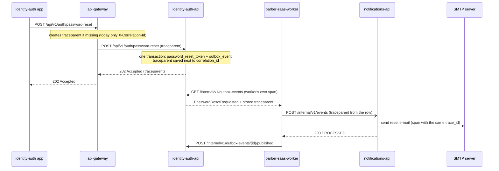

# 01 - Critical journey: password reset request

**Journey:** a user who forgot the password asks for a reset code and receives it by e-mail.
**Entry:** `POST /api/v1/auth/password-reset` (identity-auth-api).
**Why this journey:** it crosses four components (api-gateway, identity-auth-api,
barber-saas-worker, notifications-api) plus the SMTP server, it has a synchronous part and an
asynchronous part through the outbox, and it carries personal data that must never reach the logs.

Sources: barber-saas-docs `09-microservices/service-catalog.md` and `event-catalog.md`, and the
v2.0.0 code of `PasswordResetService`, `JdbcPasswordResets` (identity-auth-api), the outbox relay
of barber-saas-worker and `event_service.py` (notifications-api).

## Hops

| Step | Caller | Receiver | Protocol | Operation | Sync/Async | Data |
|---|---|---|---|---|---|---|
| 1 | identity-auth app (Ionic React) | api-gateway (nginx :8000) | REST | `POST /api/v1/auth/password-reset` `{email}` | sync | none |
| 2 | api-gateway | identity-auth-api | REST | `POST /api/v1/auth/password-reset` | sync | none yet |
| 3 | identity-auth-api | PostgreSQL schema `identity_auth` | SQL, one transaction | read `app_user` by e-mail; insert `password_reset_token` (hash only); insert `outbox_event` `PasswordResetRequested` | sync | `identity_auth` |
| 4 | identity-auth-api | api-gateway -> app | REST | `202 Accepted` (same answer if the e-mail does not exist) | sync | none |
| 5 | barber-saas-worker | identity-auth-api | internal REST, every 5 s | `GET /internal/v1/outbox-events` | async | `identity_auth.outbox_event` |
| 6 | barber-saas-worker | notifications-api | internal REST | `POST /internal/v1/events` (`PasswordResetRequested`) | async | none |
| 7 | notifications-api | MongoDB `notifications` | Mongo | check and save `processed_event` (drop duplicates) | async | `processed_event` |
| 8 | notifications-api | SMTP server | SMTP | send the e-mail with the 6-digit code (code never stored) | async | none |
| 9 | barber-saas-worker | identity-auth-api | internal REST | `POST /internal/v1/outbox-events/{id}/published` | async | `identity_auth.outbox_event` |

## Sequence diagram

## How the trace context travels

- **Steps 1-2 (HTTP):** W3C `traceparent` header. Today nginx only creates `X-Correlation-Id`
  (from `$request_id`) and identity-auth-api puts it in the MDC; `traceparent` must be forwarded
  or created at the gateway.
- **Step 3 (outbox):** `JdbcPasswordResets.saveRequest` already writes the request's correlation id
  in `outbox_event.correlation_id`. The `traceparent` must be stored in the same row.
- **Steps 5-6 (async boundary):** this is where the trace breaks today. The worker's scheduler
  creates a new `X-Correlation-Id` for every run, so notifications-api never sees the id of the
  original request. Fix: the worker reads the `traceparent` stored with each event and sends it on
  `POST /internal/v1/events`.
- **Step 8 (SMTP):** SMTP has no trace header; notifications-api records the SMTP call as a child
  span and logs it with the same `trace_id`.

## Span tree (one trace_id after the fix)

- `POST /api/v1/auth/password-reset` - api-gateway (root)
  - `POST /api/v1/auth/password-reset` - identity-auth-api (server)
    - `INSERT password_reset_token + outbox_event` - identity-auth-api (db)
  - `relay PasswordResetRequested` - barber-saas-worker (async, parent = span stored in the row)
    - `POST /internal/v1/events` - notifications-api (server)
      - `processed_event check` - notifications-api (db)
      - `SMTP send reset e-mail` - notifications-api (client)
    - `POST /internal/v1/outbox-events/{id}/published` - identity-auth-api (server)
