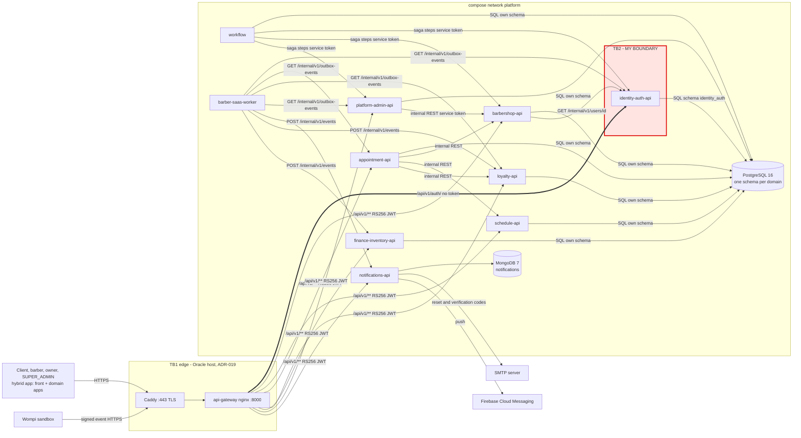

# 01 - Attack surface and trust boundaries

My boundary: **TB2 · api-gateway → identity-auth-api (public `/api/v1/auth/` endpoints)**, claimed in
barber-saas-docs #151. TB1 (Internet → edge: Caddy + api-gateway) is #150 and TB4 (worker → domain
`/internal` endpoints) is #149.

Sources: barber-saas-docs `05-architecture/overview.md`, `09-microservices/service-catalog.md`,
`02-domain/domain-events.md`, ADR-016, ADR-017, ADR-018, ADR-019, and the nginx routes of
barber-saas-api-gateway (`nginx/routes/identity-auth.conf`).

## Data flow

TB3 = each service → its own schema in the single PostgreSQL. TB5 = notifications-api → SMTP and
FCM. TB6 = Wompi → platform-admin-api. There is no message broker: events travel by the outbox
relay (ADR-016).

## Asset inventory (my domain: identity-auth)

| Asset | Where it lives | Classification |
|---|---|---|
| User password | request body of `POST /api/v1/auth/login` and `/register`; BCrypt hash in `identity_auth.app_user` | Restricted |
| JWT signing private key (`JWT_PRIVATE_KEY`) | environment of identity-auth-api only | Restricted |
| Access token (RS256, 24 h, `JWT_LIFETIME_SECONDS` 86400) | response of `/login` and `/refresh`, then every request through the gateway | Restricted |
| Refresh token (opaque, 7 days) | response of `/login`; SHA-256 hash in `identity_auth.refresh_token` | Restricted |
| Password reset and e-mail verification codes (6 digits, 15 min) | hash in `identity_auth.password_reset_token` and `identity_auth.email_verification_code`; plain in the outbox payload | Restricted |
| E-mail, full name and role of every user | `identity_auth.app_user` | Confidential |
| Public key set (`GET /api/v1/auth/jwks`) | identity-auth-api | Public |

## Entry points of TB2

| Entry point | Who calls it | Authentication today |
|---|---|---|
| `POST /api/v1/auth/register` | anyone on the internet (owner or client sign-up) | none; gateway rate limit burst 5 |
| `POST /api/v1/auth/login` | any user | none; e-mail + password |
| `POST /api/v1/auth/refresh` | the app | refresh token in the body |
| `POST /api/v1/auth/password-reset` and `/confirm` | anyone | none; 6-digit code, 5 wrong attempts, 1 request per minute |
| `POST /api/v1/auth/email-verification/confirm` and `/resend` | new user | none; 6-digit code (ADR-018) |
| `POST /api/v1/auth/barbershop-token` | signed-in client | RS256 JWT |
| `GET /api/v1/auth/me`, `POST /api/v1/auth/me/password`, `POST /api/v1/auth/logout` | signed-in user | RS256 JWT: the gateway only checks that the header exists, identity-auth-api verifies the signature |
| `GET /api/v1/auth/jwks` | the other services, to verify tokens | none (public keys) |

Port: identity-auth-api listens on 8080 with `expose` only; the gateway is the only way in from the
host. `/internal/v1/**` of identity-auth-api is never routed by the gateway.
