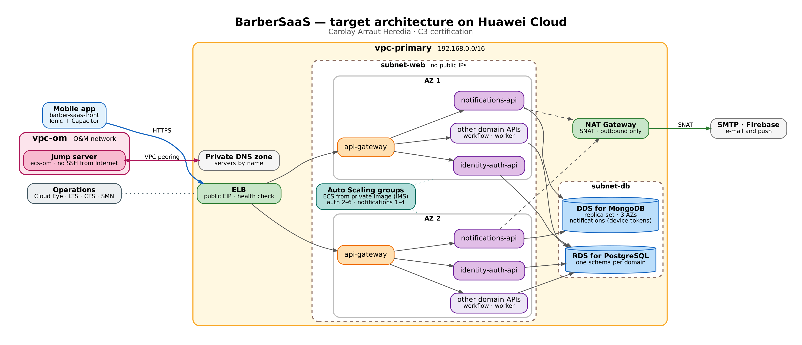

# Architecture design note — BarberSaaS

## 1. Target architecture

| Component in the diagram | Defined in (file of your team's -docs) |
|---|---|
| Mobile app (`barber-saas-front`, Ionic and Capacitor) | `05-architecture/decisions/records/ADR-013-hybrid-mobile-interface.md` |
| ELB with a public IP, in front of `barber-saas-api-gateway` (nginx), the only entry for `/api/v1/**` | `05-architecture/overview.md` §4.2, `05-architecture/deployment.md` §3 |
| Domain services (`identity-auth-api`, `barbershop-api`, `schedule-api`, `appointment-api`, `loyalty-api`, `finance-inventory-api`, `platform-admin-api`, `workflow`) in Auto Scaling groups of ECS built from private images | `09-microservices/service-catalog.md` |
| `notifications-api` (Python, FastAPI) in its own Auto Scaling group | `09-microservices/service-catalog.md` |
| `worker`, which relays the outbox events over internal HTTP | `05-architecture/decisions/records/ADR-016-event-transport-worker-relay.md` |
| RDS for PostgreSQL, one schema per domain | `05-architecture/decisions/records/ADR-011-single-instance-per-engine.md`, `06-data/models.md` |
| DDS for MongoDB (replica set across three AZs) for `notifications` | `05-architecture/decisions/records/ADR-006-database-engine-per-domain.md`, `06-data/models.md` §7 |
| NAT Gateway with an SNAT rule for outbound traffic to SMTP and Firebase | `05-architecture/overview.md` §2 |
| O&M VPC (`vpc-om`) with a jump server, VPC peering and a private DNS zone | `05-architecture/deployment.md` §3, `05-architecture/decisions/records/ADR-020-hosting-azure-for-students.md` |

Client traffic first reaches the public IP of the load balancer (ELB), which spreads the requests. From there everything
goes to the API gateway, the only authorized path (`/api/v1/**`) into the system. The microservices run on ECS servers
created from private images and grouped in Auto Scaling groups across two availability zones, so a faulty instance is
replaced automatically. For storage they use RDS for PostgreSQL with one schema per domain, and DDS for MongoDB only for
notifications. The internal servers have no public IP: they reach the Internet through a NAT Gateway with an SNAT rule,
which lets them send e-mails over SMTP and push notifications through Firebase. For security there is no direct SSH from
the Internet; the support team enters through a jump server in a separate VPC (`vpc-om`) connected with VPC peering, and
a private DNS zone lets them reach the servers by name instead of by IP address.

## 2. Five principles

| Principle | Current weakness | Evidence in -docs | Design decision | Huawei Cloud service |
|---|---|---|---|---|
| Reliability | Everything runs on a single virtual machine, so one hardware or network problem takes the whole app down | `05-architecture/decisions/records/ADR-020-hosting-azure-for-students.md` (Consequences: "One VM is still a single point of failure") | Spread the services over several ECS servers in at least two availability zones behind a load balancer, so when one server fails the traffic goes to the servers that are still alive and the user does not notice | ECS, ELB, multiple AZs |
| Security | The VM has a public IP, port 22 is reachable from the Internet for the operator, and the secrets live in a file on its disk | `05-architecture/decisions/records/ADR-020-hosting-azure-for-students.md` (Network, Secrets) | Remove every public IP from the application servers and isolate them in a private subnet; nobody uses SSH from the Internet, the team enters through a jump server in an isolated O&M VPC connected with VPC peering, and the servers go out through a NAT Gateway (ADR-C3-01) | VPC, security groups, VPC peering, NAT Gateway, private DNS |
| Performance efficiency | There is no way to add servers when logins grow in the peak hours; the only option is a bigger VM | `05-architecture/decisions/records/ADR-020-hosting-azure-for-students.md` (one `Standard_B2as_v2`, 2 vCPU) | Use Auto Scaling groups: when the peak hours come and the logins rise, the system detects the load and adds new ECS servers in a few minutes to keep the app fast | Auto Scaling, Cloud Eye |
| Cost | The VM runs all day even when there are no clients, and left on it spends about USD 86 of credit a month | `05-architecture/decisions/records/ADR-020-hosting-azure-for-students.md` (Consequences) | The same Auto Scaling removes the extra servers at night when the use goes down, so BarberSaaS pays only for the resources it needs at each moment instead of machines that are on 24/7 doing nothing | Auto Scaling (pay-per-use ECS) |
| Operations | When something fails, the VM is fixed by hand, most containers have no restart policy, and there is no record of who changed what | `05-architecture/decisions/records/ADR-020-hosting-azure-for-students.md` (Operation), `05-architecture/deployment.md` §7 | Automate the recovery: when the ELB health check finds a server that is stuck or down, Auto Scaling deletes it and starts an identical copy from the private image, with nobody fixing it by hand; Cloud Trace Service works as a "black box" that records every change and access, so we always know who modified what | ELB health check, Auto Scaling, IMS, CTS |

## 3. Scalability

| Service | Scaling metric | Threshold (number and unit) | Min instances | Max instances |
|---|---|---|---|---|
| `identity-auth-api` | Average CPU usage of the Auto Scaling group | 70 % | 2 | 6 |
| `notifications-api` | Average memory usage of the Auto Scaling group | 70 % | 1 | 4 |

I chose these two services because authentication is the critical bottleneck for people to enter the app when there is
a lot of traffic, and notifications are vital to make sure that clients come to their appointments.
`identity-auth-api` scales on CPU because checking passwords and creating session tokens uses a lot of processor,
above all in the peak hours. It keeps at least 2 servers, one per availability zone, so there is always redundancy,
and it stops at 6. `notifications-api` scales on memory and keeps only 1 server, because at night the demand is almost
zero; it grows up to 4 when it has to send bursts of e-mails and push messages.

## 4. Disaster recovery

- Critical data store: the DDS for MongoDB database `notifications`, which keeps the `device_token` of the phones (`06-data/models.md` §7). If the tokens are lost it is impossible to send the push notifications, the clients forget their appointments and the barbershops lose money.
- RTO: 5 minutes
- RPO: 1 minute
- DR pattern (chapter 11): active-standby across availability zones (a DDS replica set with one primary and two secondary nodes in three AZs)
- Why the pattern meets those numbers: if the zone of the primary node goes down, one of the secondary nodes takes the primary role automatically, so the service comes back in a few minutes without the support team doing anything by hand. Because the secondary nodes copy the changes all the time, in the worst case only the tokens of the last minute are lost, and they are registered again as soon as the users open the app.

## 5. Automated deployment

| Stage | Trigger | Tool or service | File in your team's repositories |
|---|---|---|---|
| Build | Every pull request to `develop` and `qa` | GitHub Actions (`mvn -B verify` for Java, `pytest` for Python) | `barber-saas-identity-auth-api/.github/workflows/ci.yml` |
| Test | In the same pull request run; the database job checks that each Liquibase change can be applied and also undone | GitHub Actions, Liquibase | `barber-saas-notifications-api/.github/workflows/ci.yml`, `barber-saas-identity-auth-db/.github/workflows/db-ci.yml` |
| Image | Merge into `qa` | IMS: a new private image built from the container of the service, used as a standard template | `barber-saas-identity-auth-api/deploy/Dockerfile` |
| Deploy to qa | Automatic, after the new image is created | Auto Scaling: a new AS configuration that points to the new image, and the group replaces the old servers little by little (rolling update) | `barber-saas-infra-postgres/scripts/migrate.sh` |
| Deploy to production | Manual, only when the pull request to `main` is approved by the teacher or the technical lead | Auto Scaling, with the same image tested in qa | `barber-saas-infra-postgres/deploy/azure/README.md` |
| Rollback | When a critical failure is found after a deployment | Auto Scaling goes back to the previous AS configuration (the old stable image); the schema goes back with the Liquibase rollback scripts | `barber-saas-identity-auth-db/05_rollbacks/` |

Building one private image per version and changing only the AS configuration means qa and production run exactly the
same template. The rolling update keeps part of the servers online while the others are replaced, so the users do not
see a cut, and a rollback is only a change back to the previous configuration: the new servers with the error are
removed and servers with the previous version start again.

## 6. Decisions

- [ADR-C3-01](ADR-C3-01.md): a jump server in a separate O&M VPC, connected to the main VPC with VPC peering and a private DNS zone, so the application servers need no public IP and nobody uses SSH from the Internet.
- [ADR-C3-02](ADR-C3-02.md): the notifications database on a DDS for MongoDB replica set across three availability zones (active-standby), so a zone failure does not stop the push reminders.
